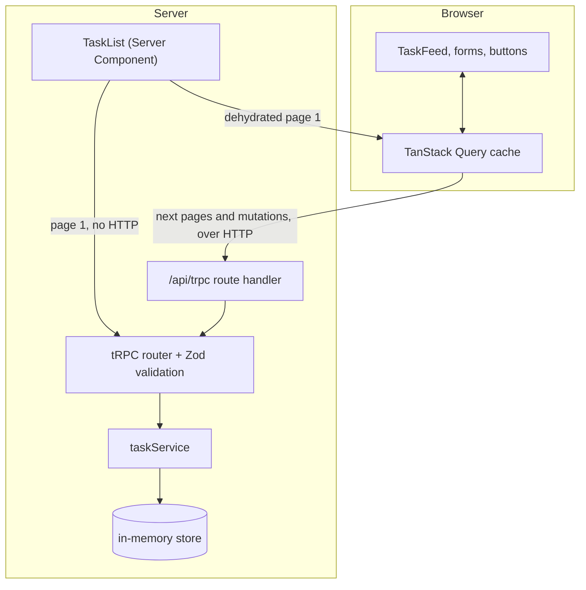

# tRPC + Next.js Todo List

A small task list where you can create, list, edit and delete tasks. The browser and the server share types through tRPC, the first page of tasks is loaded on the server, and more tasks load as you scroll.

Tasks are kept **in memory**: there is no database, and restarting the server clears them.

- [Getting started](#getting-started)
- [Tech stack](#tech-stack)
- [How it fits together](#how-it-fits-together)
- [Strategies](#strategies)
- [Decisions, commit by commit](#decisions-commit-by-commit)
- [Known limits](#known-limits)

## Getting started

You need Node.js 20.19+, 22.13+, or 24+.

```bash
npm install
npm run dev
```

Then open [http://localhost:3000](http://localhost:3000). Use **Add 50 tasks** to get enough data to try the infinite scroll.

| Command | What it does |
| --- | --- |
| `npm run dev` | Starts the development server (Turbopack) |
| `npm run build` | Creates a production build |
| `npm start` | Serves the production build |
| `npm run lint` | Runs ESLint |
| `npm test` | Runs all tests once |
| `npm run test:watch` | Re-runs tests as files change |
| `npx tsc --noEmit` | Checks types |

Stop the dev server before running `npm run build`: both write to `.next` and can break each other.

**Optional setting:** `APP_URL` is the base URL used when a Client Component has to call the API while rendering on the server. This only happens if the server-side load of the first page fails. It defaults to `http://localhost:3000`.

## Tech stack

| Tech | Role here |
| --- | --- |
| [Next.js 15](https://nextjs.org) (App Router) and React 19 | Pages, Server and Client Components, API route |
| [tRPC 11](https://trpc.io) | Typed API: the client infers its types from the server's router |
| [TanStack Query 5](https://tanstack.com/query) | Client cache, infinite query, mutations |
| [Zod 4](https://zod.dev) | Runtime validation of every input |
| TypeScript 5 (strict) | Compile-time checks across client and server |
| [Vitest 4](https://vitest.dev), Testing Library, jsdom | Backend and frontend tests |
| CSS Modules | Component styles |

## How it fits together



```text
src/
├── app/
│   ├── api/trpc/[trpc]/   HTTP entry point for tRPC
│   ├── components/        one folder per component, with its tests beside it
│   ├── hooks/             shared client hooks
│   ├── error.tsx          last-resort error page
│   └── page.tsx           the only page
├── server/services/       business logic and storage; knows nothing about tRPC
├── shared/                field limits and Zod schemas
├── test/                  test setup and helpers
└── trpc/                  router, server and client wiring, error handling
```

### The task model

| Field | Type | Notes |
| --- | --- | --- |
| `id` | string | Unique UUID, generated by the server |
| `titulo` | string | Required, 1 to 200 characters after trimming |
| `descricao` | string | Optional, up to 2000 characters |
| `dataCriacao` | number | Creation time in milliseconds, set by the server |

### The API

| Procedure | Input | Returns |
| --- | --- | --- |
| `listTasks` | `{ cursor?, limit? }` (default 20, max 50) | `{ items, nextCursor }`, newest first |
| `createTask` | `{ titulo, descricao? }` | The new task |
| `updateTask` | `{ id, titulo?, descricao? }` | The updated task; `descricao: null` removes the description |
| `deleteTask` | `{ id }` | `{ id }` |
| `addSampleTasks` | `{ count }` (1 to 100) | `{ created }` |
| `clearTasks` | none | `{ deleted }` |

## Strategies

### Loading tasks

1. **The server loads page 1.** `TaskList` calls the router directly, without an HTTP request, and hands the result to the browser's cache. The list appears already filled.
2. **The browser loads the rest.** `TaskFeed` requests the next page when the end of the list is about 600px away.
3. **Pages use a cursor, not a page number.** The cursor is the creation time and `id` of the last task shown, so creating or deleting tasks while scrolling doesn't repeat or skip any.

The server and the browser must use the same query input, or the browser ignores the prefetched page. Both import it from `TaskFeed/feed-options.ts`.

### Saving changes

Every mutation goes through `useMutation` and then invalidates `listTasks`. The pages already loaded are refetched, so the list updates without losing what was scrolled in.

### Contract between front and back

- **At build time:** the client's types come from `AppRouter`, so a mismatch fails the type check.
- **At run time:** Zod validates every input on the server.
- **Shared limits:** the forms and the schemas use the same maximum lengths, from `shared/task-limits.ts`.

### Errors

| Situation | What the user sees |
| --- | --- |
| Invalid field | The message next to that field |
| Task no longer exists | "Task … not found" |
| Server unreachable | "Can't reach the server…" |
| Unexpected server error | A generic message; the API route logs the details on the server |
| First load fails | "Couldn't load tasks" with **Retry** |
| Next page or refresh fails | Loaded tasks stay visible, with **Retry** |
| Anything else while rendering | `error.tsx`, with **Try again** |

Outside development, the API sends neither the original message of an unexpected error nor any stack trace to the browser.

### Testing

- **Backend tests** (Node) cover the service, the router, and the HTTP error contract through the real route handler.
- **Frontend tests** (jsdom) render real components. Most call the real router in-process instead of mocking tRPC, so they also exercise validation and the service.

They do not cover real browser scrolling or layout: the `IntersectionObserver` is simulated.

## Decisions, commit by commit

Oldest first.

### `b98a3af` Initial commit from Create Next App

The starting template: Next.js with the App Router, TypeScript and ESLint.

### `68d9ce0` Clean up and make minimum value out of trpc exposed to client

- **What:** removed the template page and added a first demo of the API route. The route was a plain handler that echoed requests, without the tRPC library.
- **Left to fix:** a Server Component called the app's own API over HTTP, built the URL from request headers, and sent a "create" request on every render.

### `60571a9` Create trpc solid layers and apply create, delete and list

- **What:** installed tRPC, TanStack Query and Zod, replaced the demo, and introduced the task model. The API also got `updateTask`; its UI came in the next commit.
- **Call the router directly on the server.** This avoids a needless HTTP request, keeps types, and no longer trusts request headers to build a URL.
- **Write only on user actions.** Rendering a page should never create data.
- **Keep the service free of tRPC.** The storage can change without touching the API.
- **Store `dataCriacao` as a number.** A `Date` would become a string in JSON while its type still said `Date`.
- **Keep the store on `globalThis`.** Next bundles pages and API routes separately, and each could otherwise get its own copy.

### `c3fd690` Add update to the client UI and functionality

- **What:** edit a task directly in its list item.
- **Edit in place.** The item switches between viewing and editing, so no extra page is needed. If saving fails, the form stays open.

### `6f3b2e4` Add unit test suites for backend and frontend

- **What:** added Vitest and gave each component a folder with its test beside it.
- **Split the tests into two projects.** The backend runs in Node and the frontend in jsdom, each in the environment it needs.
- **Use the real router in component tests.** A mock could keep passing after the backend changed.
- **Skip `jest-dom`.** Its version at the time conflicted with the project's dependencies, and plain assertions were enough.

### `85dfc70` Add bulk add and delete items, for smoke testing

- **What:** the **Add 50 tasks** and **Clear all** buttons.
- **Use one request per button.** Fifty separate requests would be slower and could fail halfway. The count is limited to 100.

### `6ebeb2a` Add basic pagination

- **What:** 10 tasks per page, with the page number in the URL (`?page=2`).
- **Start simple.** Pages could be linked to, and no extra client code was needed. The next commit replaced this.

### `1116c25` Add pagination and loading spinner

- **What:** replaced numbered pages with infinite scroll, and added a centered spinner.
- **Switch to a cursor.** With numbered pages, tasks created or deleted while browsing shift the rest, causing repeats or gaps.
- **Show newest first.** Otherwise a new task would land at the end, out of sight.
- **Make creation times strictly increase.** Tasks created in the same millisecond keep their order.
- **Invalidate the cache instead of refreshing the page.** The list now lives in the browser's cache, and refreshing could put page 1 back over the pages already loaded.
- **Drop the total count.** A cursor doesn't need one; reading one extra task shows whether more exist.
- **Force dynamic rendering.** Otherwise the page could be built once and keep showing old data.
- **Delay the spinner by 150 ms.** Quick requests don't make it flash. The Next.js development badge was turned off in favour of this spinner.

### `c5066c1` Add error treatment standardization

- **What:** one consistent way to report and show errors.
- **Format errors on the server.** Users previously saw raw Zod output. Fields now have readable messages.
- **Hide internal details.** Error messages and stack traces can contain secrets such as connection strings, so they stay on the server outside development.
- **Wait for Retry after a failed page.** The scroll observer could otherwise repeat a failing request in a loop.
- **Contain a failed first load.** An error boundary around the list keeps the rest of the page usable.
- **Share the limits.** The forms and the server previously had separate copies that could drift apart.
- **Replace `prefetchInfiniteQuery` with `infiniteQuery`.** TanStack Query deprecated the former. Unlike it, `infiniteQuery` rejects on failure, so the error is caught and logged, and the browser tries again.

## Known limits

- **No persistence.** The store belongs to one server process. On serverless or with several instances, each would have its own tasks. A database would replace the storage in `server/services/task.ts`.
- **No authentication.** Anyone who can reach the app can change every task, including through `addSampleTasks` and `clearTasks`, which exist for testing. Remove or protect them before deploying.
- **Very long lists.** Every loaded page stays in memory and is refetched after each change. `maxPages` and list virtualization are possible next steps.
- **Responses aren't validated at run time.** An old browser tab talking to a newer server relies on types that may no longer match.
